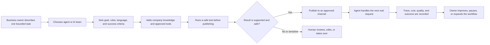
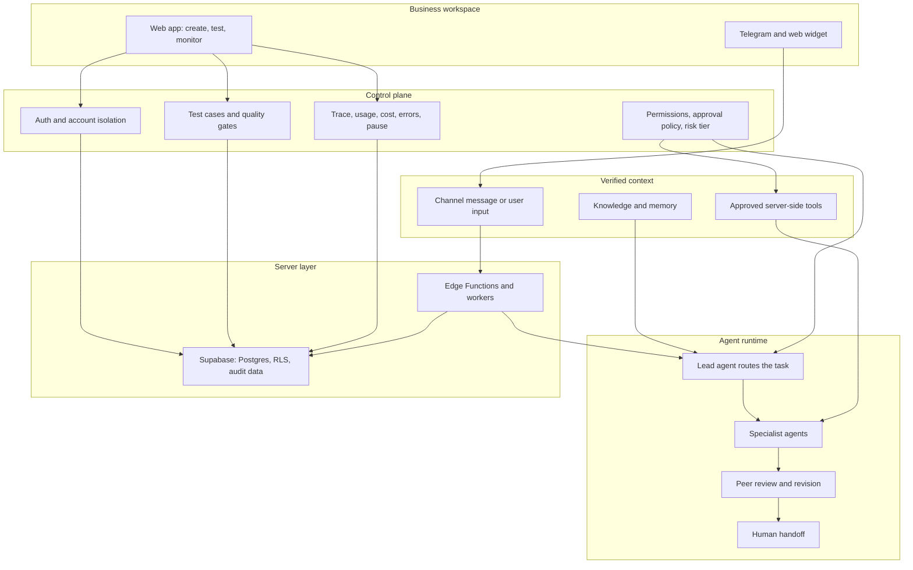
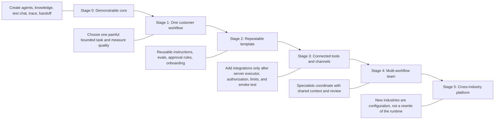

# Nemo AI: Miro Board Blueprint

Create one Miro board named `Nemo AI - User Journey, System, and Scale Plan`.

Use three horizontal frames from left to right. Paste the labels below as sticky notes, then connect them in the stated order.

## Frame 1: User Journey

Title: `From a business task to a supervised result`

Sticky notes:

1. `Business owner describes one task`
2. `Create one agent or a team`
3. `Define boundaries: what the agent may not do`
4. `Connect knowledge, tools, and channel`
5. `Test with synthetic input`
6. `Publish only after a passing test`
7. `Agent prepares work`
8. `Human approves consequential actions`
9. `Trace and improve the workflow`

## Frame 2: Nemo System

Title: `Permission-bound AI workforce runtime`

System principles:

- `No secrets in the frontend.`
- `Each account is isolated by authorization and RLS.`
- `Tools run on the server and only with configured permission.`
- `Unknown facts stay unknown; the agent must not invent them.`
- `Payments, refunds, publishing, pricing, orders, legal, medical, hiring, and other consequential actions require human approval.`
- `Every run can be traced, paused, revised, or escalated.`

## Frame 3: Scale Plan

Title: `One repeatable workflow at a time`

Scale gates:

| Stage | Proof before moving forward |
| --- | --- |
| Demonstrable core | The workflow succeeds three times with synthetic non-sensitive data. |
| One customer workflow | A real user confirms the problem and agrees on a measurable success criterion. |
| Repeatable template | At least two similar customers can configure the workflow without a custom code fork. |
| Connected tools and channels | Server executor, account authorization, concrete limits, audit record, and live smoke test exist. |
| Multi-workflow team | Routing, handoff, evaluation, and cost limits remain observable. |
| Cross-industry platform | Each new industry is added as a template and policy, not hardcoded runtime behavior. |

## Investor Readout

Put these three statements at the bottom of the board:

1. `Nemo does not sell unconstrained autonomy. It sells measurable work with permission boundaries.`
2. `The first workflow proves the product; the governed runtime enables expansion.`
3. `A business starts with one responsibility, then adds teams, knowledge, tools, and channels as trust is earned.`
